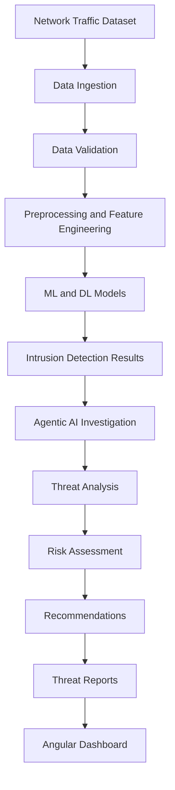

# IntrusionX

### Agentic AI-Powered Intelligent Network Intrusion Detection & Threat Investigation System

**Detect. Investigate. Defend.**

An intelligent cybersecurity platform combining Machine Learning, Deep Learning, and Agentic AI to identify suspicious network traffic, classify potential attacks, investigate model predictions, and generate understandable security reports.

---

## 1. Project Overview

IntrusionX is an AI-powered network intrusion detection and threat investigation platform designed to identify malicious network activities, classify cyberattacks, investigate suspicious traffic, and provide actionable security insights.

The system combines Machine Learning, Deep Learning, and Agentic AI to move beyond traditional intrusion detection. Instead of simply identifying suspicious traffic, IntrusionX aims to investigate detected threats, explain their characteristics, assess their severity, and recommend appropriate defensive actions.

The platform will use a structured network traffic dataset containing labeled benign and malicious network-flow records. The selected dataset must meet the requirements described in the [Dataset Research & Acquisition Requirements](#4-dataset-research--acquisition-requirements) section.

---

## 2. Project Objectives

- Detect normal and malicious network traffic.
- Classify network traffic into multiple attack categories.
- Develop and evaluate Machine Learning and Deep Learning models.
- Identify suspicious patterns and unusual network behavior.
- Use Agentic AI to investigate detected threats.
- Generate understandable threat reports and security recommendations.
- Provide a centralized dashboard for monitoring and investigation.
- Evaluate the system using realistic network traffic data.

---

## 3. Core Features

### 3.1 Network Intrusion Detection

- Benign and malicious traffic detection.
- Binary and multiclass classification.
- Real-time-ready detection architecture.
- Suspicious network-flow identification.

### 3.2 Machine Learning

**Potential algorithms:**

- Random Forest
- Decision Tree
- Logistic Regression
- Support Vector Machine
- K-Nearest Neighbors
- XGBoost
- Other suitable algorithms based on experimental results.

### 3.3 Deep Learning

**Potential architectures:**

- Artificial Neural Networks (ANN)
- Deep Neural Networks (DNN)
- Long Short-Term Memory (LSTM)
- Autoencoders
- Other suitable architectures based on the dataset and research findings.

### 3.4 Agentic AI Investigation

The Agentic AI layer will coordinate specialized agents to investigate detected threats.

**Planned agents:**

#### Detection Agent

- Receives network-flow records.
- Uses trained models to identify suspicious traffic.
- Produces detection results and confidence scores.

#### Threat Investigation Agent

- Analyzes detected attacks.
- Examines relevant network-flow characteristics.
- Investigates the predicted attack category.

#### Risk Assessment Agent

- Evaluates threat severity.
- Assigns risk levels.
- Prioritizes suspicious activities.

#### Recommendation Agent

- Generates defensive recommendations.
- Suggests suitable mitigation steps.
- Produces understandable security guidance.

#### Reporting Agent

- Generates investigation summaries.
- Records detection results.
- Prepares structured threat reports.

---

## 4. Dataset Research & Acquisition Requirements

### 4.1 Research Objective

The responsibility of the dataset researcher is to identify, verify, and acquire a suitable publicly available network intrusion detection dataset for IntrusionX.

The dataset must support supervised Machine Learning, Deep Learning, multiclass classification, and network threat analysis.

> Do not select a dataset only because its name is popular. Verify its structure, labels, attack coverage, documentation, data quality, and suitability against the requirements below.

### 4.2 Essential Dataset Characteristics

The preferred dataset should have the following characteristics:

- It should be a recognized benchmark for network intrusion detection research.
- It should originate from a cybersecurity research institution associated with a Canadian university.
- Its network traffic should have been collected during a controlled experimental environment in 2017.
- It should contain approximately five working days of captured network activity.
- The first collection day should primarily represent normal network behavior.
- The remaining collection days should contain normal and malicious network activity.
- It should include traffic generated through different network protocols and user activities.
- It should provide labeled network-flow records suitable for classification.
- Its features should be extracted using a network-flow analysis tool from the CICFlowMeter family or an equivalent documented flow extractor.

> These characteristics are research clues, not permission to ignore the technical requirements.

### 4.3 Required Traffic Categories

The dataset should contain both benign and malicious network traffic.

The preferred attack coverage includes:

| Attack Category | Description |
|---|---|
| DoS | Denial of Service attacks |
| DDoS | Distributed Denial of Service attacks |
| PortScan | Port scanning and reconnaissance |
| FTP Brute Force | Unauthorized FTP login attempts |
| SSH Brute Force | Unauthorized SSH login attempts |
| Botnet | Malicious bot-controlled network activity |
| Web Attacks | SQL Injection, XSS, and web brute-force activity |
| Infiltration | Unauthorized access or infiltration activity |
| Heartbleed | Heartbleed-related malicious traffic |

The researcher must verify which attack categories are actually present in the acquired files. Do not assume that every category exists simply because it is mentioned in a dataset description.

### 4.4 Required Data Format

The preferred format is:

- CSV (`.csv`)
- Parquet (`.parquet`) where an authentic and verifiable conversion is available.

Original PCAP files (`.pcap` / `.pcapng`) are also valuable if available, but the primary requirement is labeled flow-level data suitable for ML and DL experiments.

If the dataset is available in multiple formats, preserve the original files and document any conversion performed.

### 4.5 Required Network-Flow Features

The dataset should contain numerical or appropriately encoded features representing network-flow behavior.

**Expected feature groups include:**

#### Flow Information

- Flow Duration
- Protocol
- Source and Destination Ports, if available and appropriate

#### Packet Statistics

- Total Forward Packets
- Total Backward Packets
- Total Forward Packet Length
- Total Backward Packet Length
- Minimum, Maximum, Mean, and Standard Deviation of Packet Length

#### Traffic Statistics

- Flow Bytes per Second
- Flow Packets per Second
- Forward and Backward Packets per Second

#### Inter-Arrival Time (IAT)

- Flow IAT Mean
- Flow IAT Standard Deviation
- Flow IAT Maximum
- Flow IAT Minimum
- Forward and Backward IAT statistics

#### TCP and Protocol Indicators

- FIN Flag Count
- SYN Flag Count
- RST Flag Count
- PSH Flag Count
- ACK Flag Count
- URG Flag Count
- Other available protocol and header statistics

The researcher must provide the actual feature list from the dataset documentation or files. The above list represents desired feature groups, not a guarantee that every feature exists.

### 4.6 Label Requirements

The dataset must provide labels that allow the system to distinguish:

- Benign network traffic.
- Malicious network traffic.
- Individual attack categories or attack types.

The labels should be documented and consistently represented.

**The researcher must identify:**

- The exact label column name.
- All unique labels.
- Number of records per label.
- Whether labels are binary, multiclass, or both.
- Whether any labels are missing, ambiguous, or inconsistent.

### 4.7 Dataset Quality Requirements

**Before recommending a dataset, inspect:**

- Missing values.
- Duplicate records.
- Infinite values.
- Invalid or inconsistent labels.
- Incorrect data types.
- Class imbalance.
- Constant or redundant features.
- Potential data leakage.
- Inconsistent column names across files.
- Whether identifiers or timestamps could cause misleading model performance.

Do not remove or modify original data during initial inspection. Keep raw files separate from processed data.

### 4.8 Dataset Research Clues

Use these clues to guide the search:

- A widely referenced network intrusion detection benchmark published by a Canadian cybersecurity research institution.
- Associated with the University of New Brunswick.
- Network traffic collected over five working days in July 2017.
- Includes benign activity and multiple controlled attack scenarios.
- Provides flow-based statistical features extracted using CICFlowMeter.
- Contains multiple daily traffic files, commonly distributed as CSV files.
- Its research publication is titled around generating a new intrusion detection dataset and characterizing intrusion traffic.

The researcher should independently verify the official dataset identity and source through reliable documentation.

### 4.9 Dataset Research Deliverables

The researcher must provide the following before the dataset is accepted:

1. Official dataset name.
2. Official source or institutional download page.
3. Research paper or official documentation.
4. Complete list of available files.
5. File formats and approximate sizes.
6. Feature list and feature descriptions.
7. All available traffic labels.
8. Number of records per label.
9. Attack categories covered.
10. Missing-value and duplicate analysis.
11. Class distribution analysis.
12. Dataset usage terms and citation requirements.
13. Any known limitations or quality issues.
14. Download instructions and file integrity checksums, if available.
15. A short explanation of why the dataset meets IntrusionX requirements.

### 4.10 Dataset Acceptance Checklist

- [ ] Official source verified.
- [ ] Dataset identity verified.
- [ ] Benign traffic available.
- [ ] Malicious traffic available.
- [ ] Multiple attack categories available.
- [ ] Labeled flow-level records available.
- [ ] Required feature groups checked.
- [ ] CSV or Parquet files available.
- [ ] Feature documentation available.
- [ ] Label documentation available.
- [ ] Class distribution inspected.
- [ ] Data quality inspected.
- [ ] Usage terms reviewed.
- [ ] Original files preserved.
- [ ] Dataset research report completed.

> **Important:** Do not begin model training until the dataset has been reviewed and approved. If the preferred dataset cannot be obtained or fails essential requirements, report the issue and propose alternatives with a comparison.

---

## 5. Proposed System Architecture

IntrusionX will follow a modular architecture.

---

## 6. Proposed Technology Stack

| Component | Technology |
|---|---|
| Programming Language | Python |
| Backend | FastAPI |
| Frontend | Angular |
| Machine Learning | Scikit-learn, XGBoost |
| Deep Learning | PyTorch or TensorFlow |
| Data Processing | Pandas, NumPy |
| Visualization | Matplotlib, Plotly, Chart.js |
| Agentic AI | LLM-based agents and orchestration framework |
| Database | PostgreSQL |
| Model Storage | Joblib / Pickle / framework-specific formats |
| API Communication | REST APIs |
| Version Control | Git and GitHub |

Final technology choices may be adjusted during implementation.

---

## 7. Proposed Project Workflow

1. Dataset research and acquisition.
2. Dataset verification and exploratory data analysis.
3. Data cleaning and preprocessing.
4. Feature engineering and feature selection.
5. Binary classification experiments.
6. Multiclass classification experiments.
7. Deep Learning model development.
8. Model evaluation and comparison.
9. Detection API development.
10. Agentic AI investigation workflow.
11. Threat assessment and recommendation generation.
12. Angular dashboard development.
13. System integration and testing.
14. Final evaluation and documentation.

---

## 8. Model Evaluation

The models should be evaluated using appropriate classification metrics:

- Accuracy
- Precision
- Recall
- F1-score
- Confusion Matrix
- ROC-AUC, where appropriate
- False Positive Rate
- False Negative Rate
- Inference Time

Because network intrusion datasets can have substantial class imbalance, accuracy alone must not be used to judge model quality.

Use carefully designed train, validation, and test splits. Where appropriate, evaluate temporal or day-based splits to reduce the risk of overly optimistic results caused by random splitting.

---

## 9. Development Roadmap

| Phase | Task | Status |
|---|---|---|
| 1 | Project planning and requirements | Planned |
| 2 | Dataset research and acquisition | Pending |
| 3 | Dataset analysis and preprocessing | Pending |
| 4 | ML model development | Pending |
| 5 | DL model development | Pending |
| 6 | Model evaluation and selection | Pending |
| 7 | FastAPI backend | Pending |
| 8 | Agentic AI integration | Pending |
| 9 | Angular dashboard | Pending |
| 10 | System integration | Pending |
| 11 | Testing and final documentation | Pending |

---

## 10. Security and Responsible Use

IntrusionX is intended for defensive cybersecurity research, network monitoring, and security analysis.

- Use datasets and network captures only where access is authorized.
- Do not perform unauthorized network scanning or attacks.
- Protect sensitive network information.
- Validate model predictions before taking defensive action.
- Keep human oversight for consequential security decisions.
- Clearly document false positives, false negatives, and model limitations.

---

## 11. Expected Outcome

The expected outcome is a modular intelligent intrusion detection platform capable of:

- Analyzing network-flow data.
- Detecting benign and malicious traffic.
- Classifying different attack categories.
- Investigating suspicious activity through specialized AI agents.
- Assessing threat severity.
- Producing understandable security reports.
- Providing actionable defensive recommendations through a dashboard.

---

## 12. Important Instructions for the Dataset Researcher

> **The immediate task is dataset research and acquisition only.**

Please do not start building ML models, preprocessing pipelines, or application modules as part of this assignment.

First, carefully read the dataset requirements, search for the most suitable dataset, verify it through its official documentation, and provide the requested research deliverables.

The dataset must be approved before it becomes the foundation of the IntrusionX development process.

---

**IntrusionX — Detect. Investigate. Defend.**

