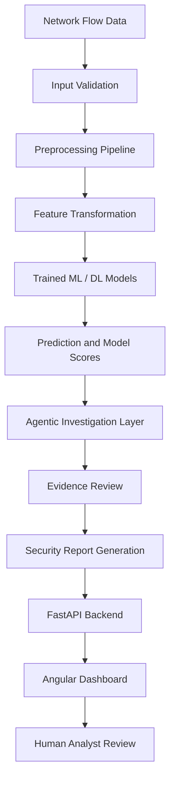
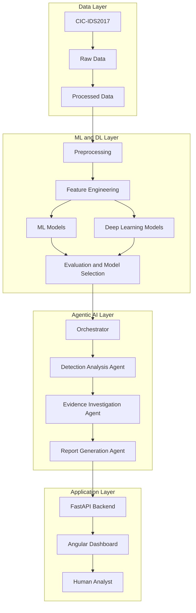
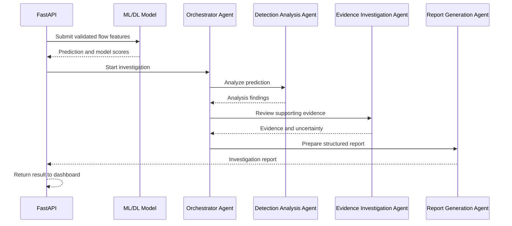

<div align="center">

# IntrusionX

### Agentic AI-Powered Intelligent Network Intrusion Detection & Threat Investigation System

**Detect. Investigate. Defend.**

An intelligent cybersecurity platform combining Machine Learning, Deep Learning, and Agentic AI to identify suspicious network traffic, classify potential attacks, investigate model predictions, and generate understandable security reports.


</div>

---

## Table of Contents

- [1. Project Overview](#1-project-overview)
- [2. Problem Statement](#2-problem-statement)
- [3. Project Objectives](#3-project-objectives)
- [4. Core Features](#4-core-features)
- [5. Dataset](#5-dataset)
- [6. System Workflow](#6-system-workflow)
- [7. System Architecture](#7-system-architecture)
- [8. Machine Learning and Deep Learning](#8-machine-learning-and-deep-learning)
- [9. Agentic AI Architecture](#9-agentic-ai-architecture)
- [10. Technology Stack](#10-technology-stack)
- [11. Project Structure](#11-project-structure)
- [12. Development Roadmap](#12-development-roadmap)
- [13. Installation and Setup](#13-installation-and-setup)
- [14. Running the Project](#14-running-the-project)
- [15. Evaluation Strategy](#15-evaluation-strategy)
- [16. Security and Reliability Considerations](#16-security-and-reliability-considerations)
- [17. Expected Output](#17-expected-output)
- [18. Current Development Status](#18-current-development-status)
- [19. Future Scope](#19-future-scope)
- [20. Disclaimer](#20-disclaimer)
- [21. Acknowledgements](#21-acknowledgements)
- [22. License](#22-license)

---

## 1. Project Overview

**IntrusionX** is an AI-powered Network Intrusion Detection and Threat Investigation System designed to analyze network-flow data and identify potentially malicious activity.

The project combines three major areas of Artificial Intelligence:

1. **Machine Learning (ML):** Traditional classification algorithms for network traffic analysis.
2. **Deep Learning (DL):** Neural-network-based models to learn complex patterns in network traffic.
3. **Agentic AI:** Specialized AI agents that coordinate investigation tasks, interpret detection results, gather supporting evidence, and prepare human-readable security reports.

The initial model-development phase will use the **CIC-IDS2017 (Canadian Institute for Cybersecurity Intrusion Detection System 2017) dataset**.

IntrusionX is intended to go beyond a basic Benign-versus-Attack classifier. Its planned workflow will identify suspicious traffic, predict an attack category, assess model confidence, investigate relevant evidence, and present the findings through a security dashboard.

> **Important:** IntrusionX is under active development. Features described as planned or proposed are not yet claims of completed implementation. Model performance will be reported only after reproducible experiments and independent evaluation.

## 2. Problem Statement

Modern networks generate large volumes of traffic, making manual inspection difficult and time-consuming. Malicious activity can be hidden among legitimate connections, and security teams need useful information to understand and prioritize suspicious events.

A basic intrusion detection model may produce a prediction such as `Attack` or `Benign`, but that result alone does not necessarily explain:

- Which attack category may be involved?
- Which network-flow characteristics influenced the prediction?
- How confident is the model?
- What additional evidence should be examined?
- How should an analyst interpret the finding?
- What should be investigated next?

IntrusionX aims to address these challenges by combining predictive models with an investigation workflow that produces structured, understandable findings for human review.

## 3. Project Objectives

The primary objectives are:

- Acquire and understand the CIC-IDS2017 dataset.
- Perform systematic data cleaning, preprocessing, and exploratory analysis.
- Identify relevant network-flow features and investigate redundant variables.
- Train and compare multiple Machine Learning algorithms.
- Develop and evaluate Deep Learning models.
- Support binary classification: Benign versus Attack.
- Extend detection to multiclass attack classification.
- Evaluate models using appropriate metrics, including per-class recall and F1-score.
- Integrate trained models into a modular Agentic AI architecture.
- Investigate suspicious predictions using available model outputs and evidence.
- Generate structured, understandable security reports.
- Develop a FastAPI backend and Angular dashboard.
- Test the complete workflow from input data to final report.

## 4. Core Features

The following features describe the intended system capabilities.

### 4.1 Network Traffic Analysis

- Accept network-flow feature records.
- Validate input fields and data types.
- Apply the same preprocessing used during model training.
- Identify invalid, missing, infinite, or out-of-range values.
- Prepare records for model inference.

### 4.2 Binary Intrusion Detection

The initial detection task will classify traffic into:

| Class | Description |
|---|---|
| Benign | Traffic classified as normal |
| Attack | Traffic classified as potentially malicious |

### 4.3 Multiclass Attack Classification

After establishing a reliable binary baseline, the project will investigate multiclass classification for the attack categories represented in the selected dataset.

Potential categories include:

- DoS
- DDoS
- PortScan
- FTP-Patator
- SSH-Patator
- Bot
- Web Attack categories
- Infiltration
- Heartbleed

The exact label mapping and available classes will be verified against the acquired dataset files before training.

### 4.4 Prediction Confidence

The system will display model scores or probabilities where supported.

A confidence score is not a guarantee that a prediction is correct. Calibration and class-specific reliability will be evaluated before interpreting scores as probabilities.

### 4.5 AI-Assisted Threat Investigation

Planned investigation capabilities include:

- Reviewing model predictions and relevant traffic features.
- Identifying evidence associated with a predicted attack.
- Summarizing why a record may deserve attention.
- Producing investigation findings with supporting data.
- Highlighting uncertainty and recommending human review.

### 4.6 Security Reporting

The planned reporting module will provide:

- Traffic classification.
- Predicted attack category.
- Model score or confidence, where available.
- Relevant network-flow evidence.
- Investigation summary.
- Risk prioritization, when supported by defined criteria.
- Suggested next investigation steps.

### 4.7 Interactive Dashboard

The Angular dashboard is planned to present:

- Traffic analysis summaries.
- Benign and suspicious traffic counts.
- Attack-category distribution.
- Prediction details.
- Investigation reports.
- Model evaluation information.

Dashboard values will be based on actual system outputs, not fabricated sample metrics.

---

## 5. Dataset

### CIC-IDS2017

**Full name:** Canadian Institute for Cybersecurity Intrusion Detection System 2017.

**Research institution:** Canadian Institute for Cybersecurity, University of New Brunswick, Canada.

CIC-IDS2017 is a network intrusion detection dataset containing benign traffic and traffic associated with multiple attack scenarios. It includes labeled network-flow records and features that can be used for supervised learning experiments.

### Dataset source

- Official CIC dataset page: https://www.unb.ca/cic/datasets/ids-2017.html
- Institution: https://www.unb.ca/cic/

Use the official dataset source where possible and retain the dataset's original documentation.

### Dataset contents

The dataset includes network traffic captured across multiple days and attack scenarios. Depending on the distributed version, files may be provided in CSV format or other processed formats.

Examples of attack scenarios include:

| Category | Example |
|---|---|
| Denial of Service | DoS attacks |
| Distributed Denial of Service | DDoS attacks |
| Scanning | PortScan |
| Credential attacks | FTP-Patator, SSH-Patator |
| Web attacks | Web Attack categories |
| Botnet activity | Bot |
| Infiltration | Infiltration |
| Heartbleed | Heartbleed |

The exact file inventory, columns, labels, and class counts must be inspected rather than assumed.

### Data formats

The project may work with:

- `.csv`
- `.parquet`

Parquet files can be loaded directly using Pandas with an appropriate engine such as PyArrow.

```python
import pandas as pd

df = pd.read_parquet("data/raw/dataset.parquet")

print(df.head())
print(df.shape)
print(df.info())
```

For CSV files:

```python
import pandas as pd

df = pd.read_csv("data/raw/dataset.csv")

print(df.head())
print(df.shape)
print(df.info())
```

### Dataset preparation considerations

Before model training, we will investigate:

- Missing values.
- Positive and negative infinity.
- Duplicate records.
- Inconsistent column names.
- Data types.
- Label distribution.
- Class imbalance.
- Feature ranges and outliers.
- Potential data leakage.
- Dataset provenance and file-level differences.

**Important:** A random row-level split can overestimate performance when highly related or duplicate flows appear in both training and testing data. We will investigate duplicates and use a suitable split strategy, such as grouping by capture day or scenario where appropriate.

---

## 6. System Workflow

The intended end-to-end workflow is:



### Workflow explanation

1. **Input:** Network-flow records are supplied to the system.
2. **Validation:** Required features, types, and value constraints are checked.
3. **Preprocessing:** The saved preprocessing pipeline transforms the input.
4. **Inference:** Trained ML or DL models generate predictions.
5. **Investigation:** Agents examine predictions and supporting evidence.
6. **Reporting:** A structured report summarizes the findings and uncertainty.
7. **Presentation:** FastAPI exposes the results to the Angular dashboard.
8. **Human review:** An analyst reviews the result before taking security action.

---

## 7. System Architecture

IntrusionX will follow a modular architecture so that dataset processing, model training, inference, investigation, and user-interface development can evolve independently.



### Main architectural modules

| Module | Responsibility |
|---|---|
| Data layer | Dataset loading, validation, and storage |
| Preprocessing | Cleaning, transformation, and encoding |
| Feature engineering | Feature analysis, selection, and transformation |
| ML/DL layer | Model training, inference, and evaluation |
| Agentic AI layer | Investigation orchestration and report preparation |
| Backend | API endpoints, validation, and application services |
| Frontend | Dashboard and analyst-facing interface |
| Testing | Unit, integration, and end-to-end verification |

---

## 8. Machine Learning and Deep Learning

Model selection will be based on experimental results rather than assumptions.

### 8.1 Machine Learning models

Candidate algorithms include:

- Logistic Regression
- Decision Tree
- Random Forest
- Support Vector Machine (SVM)
- K-Nearest Neighbors (KNN)
- Gradient Boosting
- XGBoost, if appropriate and available

Each model will be trained using a consistent experimental setup where practical.

### 8.2 Deep Learning models

Candidate architectures include:

- Artificial Neural Network (ANN / MLP)
- Deep Feedforward Neural Network
- Other suitable tabular-data architectures, if justified by experiments

Deep Learning models will use the same carefully defined data splits and comparable evaluation metrics.

### 8.3 Binary and multiclass strategy

**Stage 1 — Binary classification**

- Benign
- Attack

**Stage 2 — Multiclass classification**

Predict the attack category from the verified set of dataset labels.

A hierarchical approach may also be evaluated:

1. Detect whether traffic is suspicious.
2. Classify the attack category for traffic predicted as malicious.

The final design will be selected using validation results and operational requirements.

### 8.4 Preprocessing pipeline

Potential preprocessing steps include:

- Remove or handle invalid records.
- Resolve duplicate records after investigation.
- Encode categorical variables where necessary.
- Scale numerical features when required by the selected algorithm.
- Apply feature selection where justified.
- Handle class imbalance using class weights or carefully applied resampling.
- Save fitted transformations for consistent inference.

Any resampling technique, including SMOTE, must be applied only to the training data after splitting. It must never be applied before the train/test split.

### 8.5 Model persistence

The selected model and its required preprocessing artifacts will be saved together with metadata.

Example:

```text
saved_models/
├── binary/
│   ├── model.joblib
│   ├── preprocessor.joblib
│   └── metadata.json
│
└── multiclass/
    ├── model.joblib
    ├── preprocessor.joblib
    └── metadata.json
```

The actual format will depend on the model framework.

---

## 9. Agentic AI Architecture

Agentic AI is a central part of IntrusionX, but it will be introduced only after the detection pipeline has been developed and evaluated.

The purpose of the agentic layer is to coordinate evidence-based investigation, not to replace the trained detection models with an LLM.

### 9.1 Proposed agents

#### 1. Orchestrator Agent

Responsibilities:

- Receive an inference result.
- Decide which investigation tasks are required.
- Coordinate specialized agents.
- Track investigation state.
- Combine verified findings into a final result.

#### 2. Detection Analysis Agent

Responsibilities:

- Review model predictions.
- Interpret available class scores.
- Examine relevant input features.
- Identify unusual or noteworthy patterns.
- Report uncertainty and limitations.

#### 3. Evidence Investigation Agent

Responsibilities:

- Gather supporting information from approved internal tools and data.
- Compare the prediction with relevant feature evidence.
- Identify inconsistencies or missing information.
- Separate observed facts from hypotheses.
- Escalate uncertain findings for human review.

#### 4. Report Generation Agent

Responsibilities:

- Organize investigation findings.
- Summarize the predicted activity.
- Include relevant evidence and limitations.
- Produce a structured security report.
- Suggest appropriate next steps for an analyst.

### 9.2 Proposed agent workflow



### 9.3 Agent design principles

- Agents must use clearly defined tools and input/output schemas.
- Investigation findings must be traceable to available evidence.
- LLM-generated explanations must not be presented as verified facts without supporting data.
- The system must preserve the original model prediction and its scores.
- Uncertain or conflicting findings must be identified.
- Human review must remain part of security-critical decisions.
- Agents must not independently block traffic or modify network infrastructure in the initial scope.

---

## 10. Technology Stack

| Area | Technology | Purpose |
|---|---|---|
| Programming language | Python | Core development |
| Data processing | Pandas, NumPy | Data analysis and preprocessing |
| Visualization | Matplotlib, Seaborn | EDA and evaluation plots |
| Machine Learning | Scikit-learn | Traditional ML algorithms |
| Deep Learning | PyTorch / TensorFlow | Neural network models |
| Dataset format | CSV / Parquet | Dataset storage and loading |
| Backend | FastAPI | REST API and inference services |
| Frontend | Angular | Security dashboard |
| Agentic AI | Python-based agent orchestration | Investigation workflow |
| Model persistence | Joblib / framework-native formats | Saving trained models |
| Testing | Pytest | Automated testing |
| Version control | Git and GitHub | Source control |

The final library versions and agent framework will be selected during implementation and recorded in the project dependencies.

---

## 11. Project Structure

The repository will use a modular structure.

```text
IntrusionX/
│
├── data/
│   ├── raw/
│   ├── processed/
│   └── samples/
│
├── notebooks/
│   ├── 01_dataset_exploration.ipynb
│   ├── 02_data_preprocessing.ipynb
│   ├── 03_feature_engineering.ipynb
│   ├── 04_ml_training.ipynb
│   ├── 05_deep_learning_training.ipynb
│   └── 06_model_evaluation.ipynb
│
├── src/
│   ├── data/
│   │   ├── loaders.py
│   │   └── validation.py
│   │
│   ├── preprocessing/
│   │   ├── cleaning.py
│   │   └── pipeline.py
│   │
│   ├── features/
│   │   ├── analysis.py
│   │   └── selection.py
│   │
│   ├── models/
│   │   ├── train_ml.py
│   │   ├── train_dl.py
│   │   └── predict.py
│   │
│   └── evaluation/
│       ├── metrics.py
│       └── reports.py
│
├── saved_models/
│   ├── binary/
│   └── multiclass/
│
├── agents/
│   ├── orchestrator.py
│   ├── detection_analysis.py
│   ├── evidence_investigation.py
│   └── report_generation.py
│
├── backend/
│   ├── app/
│   │   ├── main.py
│   │   ├── api/
│   │   ├── schemas/
│   │   └── services/
│   └── tests/
│
├── frontend/
│   └── intrusionx-dashboard/
│
├── reports/
│   ├── figures/
│   ├── model_evaluations/
│   └── investigations/
│
├── tests/
│   ├── test_data.py
│   ├── test_preprocessing.py
│   ├── test_models.py
│   └── test_integration.py
│
├── configs/
├── requirements.txt
├── .gitignore
├── LICENSE
└── README.md
```

**Note:** This is the target structure. Directories and files will be added as their corresponding modules are implemented.

---

## 12. Development Roadmap

Development will follow these phases in sequence.

| Phase | Task | Expected outcome |
|---|---|---|
| 01 | Dataset acquisition and inspection | Verified dataset inventory |
| 02 | Data cleaning and preprocessing | Reusable clean-data pipeline |
| 03 | Exploratory Data Analysis | Statistical and visual insights |
| 04 | Feature engineering and selection | Documented feature pipeline |
| 05 | Machine Learning training | Evaluated ML baselines |
| 06 | Deep Learning training | Evaluated neural-network models |
| 07 | Model evaluation and comparison | Evidence-based model selection |
| 08 | Agentic AI integration | Coordinated investigation workflow |
| 09 | FastAPI backend | Model inference and investigation APIs |
| 10 | Angular dashboard | Analyst-facing application |
| 11 | Testing and refinement | Verified end-to-end workflow |
| 12 | Documentation and release preparation | Reproducible project release |

### Development rule

We will not move to the next major phase until the current phase has:

- Working implementation.
- Successful tests.
- Documented results.
- Identified limitations.
- Reproducible outputs.

---

## 13. Installation and Setup

### Prerequisites

Install the following:

- Python 3.x compatible with the selected dependencies.
- Node.js and npm.
- Angular CLI compatible with the chosen Angular version.
- Git.
- A code editor such as Visual Studio Code.
- Sufficient storage and memory for dataset processing.

Dataset size and model-training requirements depend on the files and experiments selected.

### Step 1 — Clone the repository

```bash
git clone https://github.com/YOUR_USERNAME/IntrusionX.git
cd IntrusionX
```

Replace `YOUR_USERNAME` with the actual GitHub username after repository creation.

### Step 2 — Create a virtual environment

Windows:

```bash
python -m venv .venv
.venv\Scripts\activate
```

Linux / macOS:

```bash
python3 -m venv .venv
source .venv/bin/activate
```

### Step 3 — Install dependencies

After the initial dependency list is finalized:

```bash
pip install -r requirements.txt
```

Core data-science packages can be installed during the initial dataset exploration phase:

```bash
pip install pandas numpy pyarrow matplotlib seaborn scikit-learn jupyter
```

Install PyTorch or TensorFlow according to the selected framework and the machine's hardware requirements.

### Step 4 — Prepare the dataset

Place the original dataset files under:

```text
data/raw/
```

Keep original source files unchanged. Store cleaned and transformed outputs under:

```text
data/processed/
```

Do not commit the full dataset to Git unless its license, size, and redistribution terms have been checked. Large datasets should generally be downloaded separately.

---

## 14. Running the Project

The exact commands will be added as each module becomes executable.

### Dataset exploration

```bash
jupyter notebook
```

Open:

```text
notebooks/01_dataset_exploration.ipynb
```

### Backend

The planned FastAPI application will be started with a command similar to:

```bash
uvicorn backend.app.main:app --reload
```

API documentation will be available at:

```text
http://127.0.0.1:8000/docs
```

This command will be valid once the backend entry point has been implemented.

### Frontend

From the Angular application directory:

```bash
cd frontend/intrusionx-dashboard
npm install
ng serve
```

The local development URL is normally:

```text
http://localhost:4200
```

Frontend and backend configuration may change during implementation.

---

## 15. Evaluation Strategy

Accuracy alone is not sufficient for evaluating an intrusion detection system, especially when the dataset contains imbalanced classes.

### Classification metrics

| Metric | Purpose |
|---|---|
| Accuracy | Overall proportion of correct predictions |
| Precision | How many predicted positives are correct |
| Recall | How many actual positives are detected |
| F1-score | Harmonic mean of precision and recall |
| Confusion matrix | Breakdown of correct and incorrect predictions |
| ROC-AUC | Ranking performance across thresholds |
| PR-AUC | Precision-recall performance, especially useful for imbalanced data |

For multiclass experiments, metrics will be reported per class along with macro and weighted averages.

### Security-focused evaluation

We will pay particular attention to:

- Attack detection recall.
- False-positive rate.
- False-negative rate.
- Per-attack precision and recall.
- Performance on rare attack classes.
- Inference latency.
- Model size and resource usage.
- Generalization across capture days or scenarios.

### Leakage prevention

The evaluation strategy will investigate:

- Duplicate and near-duplicate flows.
- Capture-day and attack-scenario relationships.
- Train/test overlap.
- Preprocessing fitted only on training data.
- Feature-selection leakage.
- Resampling performed only on training data.

A final held-out test set must not be used repeatedly to tune the model.

### Model comparison

All candidate models will be compared using documented splits, consistent label definitions, and reproducible evaluation code. No performance score will be claimed until it has been measured.

---

## 16. Security and Reliability Considerations

IntrusionX is a decision-support and research system. Its predictions should not be treated as proof of malicious intent.

Key considerations:

1. **Input validation:** Reject malformed records and unexpected feature schemas.
2. **Preprocessing consistency:** Use the exact fitted preprocessing pipeline associated with each model.
3. **Model versioning:** Record model version, training data, feature schema, and evaluation metadata.
4. **Evidence traceability:** Keep investigation statements connected to actual model outputs and input evidence.
5. **LLM limitations:** Treat generated explanations as analysis, not ground truth.
6. **API security:** Apply authentication, authorization, rate limiting, and secure configuration before deployment.
7. **Sensitive data:** Avoid exposing private network identifiers or raw traffic details unnecessarily.
8. **Human oversight:** Require analyst review before consequential security actions.
9. **Safe operation:** The initial system will not automatically block connections or change firewall rules.
10. **Monitoring:** Track errors, inference latency, model drift, and changes in traffic distributions.

---

## 17. Expected Output

For each analyzed network-flow record, the intended system response may contain:

```json
{
  "record_id": "flow-0001",
  "prediction": {
    "binary_class": "Attack",
    "attack_category": "PortScan",
    "model_score": null
  },
  "investigation": {
    "status": "pending_implementation",
    "summary": null,
    "supporting_evidence": [],
    "uncertainties": []
  },
  "recommendation": {
    "action": "analyst_review",
    "details": "Review the flow and supporting evidence."
  }
}
```

This is an illustrative response schema, not a real prediction. The model score, attack category, evidence, and investigation status will be populated from actual system execution.

---

## 18. Current Development Status

**Project status: In Development**

The project is planned in stages. The current focus is dataset acquisition, inspection, and understanding before preprocessing and model training.

| Component | Status |
|---|---|
| Project definition | Defined |
| Project architecture | Proposed |
| CIC-IDS2017 dataset inspection | Initial phase |
| Data preprocessing | Planned |
| Exploratory data analysis | Planned |
| Feature engineering | Planned |
| ML model training | Planned |
| Deep Learning training | Planned |
| Model evaluation | Planned |
| Agentic AI integration | Planned |
| FastAPI backend | Planned |
| Angular dashboard | Planned |
| End-to-end testing | Planned |

Status labels will be updated as implementation and verification are completed.

---

## 19. Future Scope

Potential future enhancements include:

- Real-time network-flow ingestion.
- Integration with approved packet and flow collectors.
- Streaming detection and alert processing.
- Additional intrusion detection datasets.
- Cross-dataset generalization testing.
- Model drift detection and retraining workflows.
- Explainability tools such as SHAP, where appropriate.
- Analyst feedback and investigation history.
- Role-based access control.
- SIEM integration.
- Threat-intelligence enrichment through trusted sources.
- Containerized deployment.
- Monitoring and operational observability.

These are future possibilities, not current capabilities.

---

## 20. Disclaimer

IntrusionX is an educational, research, and defensive cybersecurity project.

- Predictions may contain false positives and false negatives.
- Model performance on CIC-IDS2017 does not guarantee performance on modern production networks.
- Dataset-based evaluation may not represent every real-world network environment.
- AI-generated investigation summaries can be incomplete or incorrect.
- Security decisions should be validated by qualified human analysts.
- Do not use the project to monitor, access, or interfere with networks without proper authorization.

---

## 21. Acknowledgements

We acknowledge the **Canadian Institute for Cybersecurity (CIC), University of New Brunswick**, for providing the CIC-IDS2017 dataset for cybersecurity research.

Dataset and documentation:

https://www.unb.ca/cic/datasets/ids-2017.html

---

## 22. License

A license file will be added after the repository's licensing terms are selected.

The project source-code license and the CIC-IDS2017 dataset's usage and redistribution terms are separate matters. Review the dataset's official terms before redistributing any dataset files.

---

<div align="center">

**IntrusionX**

*Detect. Investigate. Defend.*

Built with Machine Learning, Deep Learning, and Agentic AI.

</div>
